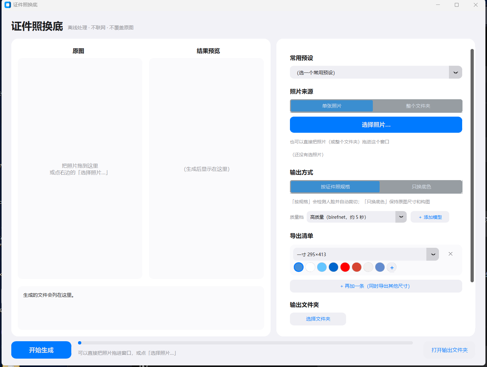

# 证件照换底

**一个完全离线的 Windows 桌面小工具：把普通照片变成蓝底 / 白底 / 红底的证件照。**

[English README](README.md)



---

## 为什么做这个

身边几个朋友要交「一寸蓝底」照片，又完全不会 PS。网上做这件事的网站都要上传，
而证件照上传一次就是一次隐私泄露。

所以干脆做成桌面工具：全程在本机跑，从不联网，直接输出 300 dpi 的冲印级 JPEG。

**关于这个项目是怎么做出来的：** 我不是专业开发者，这个项目是在 AI 的大量协助下完成的
——我描述想要什么，然后一个 bug 一个 bug 地磨。它在架构上谈不上漂亮。但下面那份
**踩坑记录**是真实且昂贵的，如果你要做类似的东西，那大概才是这个仓库里最有价值的部分。

## 已知问题：某些位置会被拒绝写入

**这是实测结论。** 如果你把程序解压在 **「下载 / 文档 / 图片 / 音乐 / 视频」**
这几个文件夹里，而待处理的照片在**桌面**上，写文件时会被 Windows 拒绝：

    PermissionError: [Errno 13] Permission denied
    PermissionError: [WinError 5] 拒绝访问

生成列表里每张照片旁边会出现 **✗**。

**规避方法**：把程序解压到一个普通目录，例如 `D:\证件照换底\`；输出文件夹也放在
普通位置，别放进上面列出的那几个文件夹。

顺便说清楚**什么样是没问题的**：**桌面本身可以用。** 只有「程序在那些文件夹里 +
照片在桌面」这个组合才会被拒。这是 Windows 的写入限制，不是程序的 bug —— 同一个
exe 放在别处就能正常写出文件。

## 功能

* **拖拽**：一张照片、或者整个文件夹，直接拖进窗口。
* **自动抠图**：从任意背景里把人抠出来，保留发丝细节。
* **人脸检测 + 自动裁切**：按选定的证件照规格对齐。
* **纯色换底**：7 个常用预设，外加完整的自定义取色。
* **自定义取色器**：饱和度/明度色域板 + 色相条 + **屏幕吸管**，屏幕上任何位置的颜色都能取
  （浏览器里、微信聊天里，都行）。
* **内置规格表**：一寸、二寸、护照、签证、驾驶证、社保卡、结婚证等（中国 + 国际）。
* **限制文件大小**：有些报名系统要求「25KB 以下」。填一个下限和/或上限，它会自动搜
  JPEG 质量来满足。
* **一次导出多个规格**：同一张照片，一次同时出「一寸蓝底」和「二寸红底」，抠图只算一次。
* **六寸相纸排版**：按 152×102mm 相纸排出尽量多的份数，直接拿去冲印。
* **自带模型**：界面里就能添加任意 ONNX 抠图模型。
* **透明 PNG**：想自己在 PS 里继续处理的人可以用这个。

## 快速开始

### 方式 A —— 直接用打包好的 exe（不需要装 Python）

1. 到 Releases 页面下载 `证件照换底.zip`。
2. 解压到**任何位置，包括中文名的文件夹**。
3. 双击 `证件照换底.exe`。

第一次运行 Windows SmartScreen 会拦一下（exe 没有代码签名，签名证书要花钱）。
点「更多信息」→「仍要运行」即可。之后全程离线。

### 方式 B —— 从源码运行

```powershell
git clone https://github.com/Cheng1933/id-photo-bg.git
cd id-photo-bg

# 1. 拉取上游抠图内核并打补丁
powershell -ExecutionPolicy Bypass -File scripts\setup_vendor.ps1

# 2. 安装 Python 依赖
python -m venv .venv
.venv\Scripts\python -m pip install -r requirements.txt

# 3. 下载模型权重（约 114 MB，放在 Release 附件里）
powershell -ExecutionPolicy Bypass -File scripts\download_models.ps1

# 4. 启动
.venv\Scripts\python run_app.py
```

也带了一个简单的命令行入口，方便脚本调用：

```powershell
python run_app.py photo.jpg out\            # 按默认规格裁切 + 蓝底
python run_app.py photo.jpg out\ --bgonly   # 保持原图构图，只换背景色
```

## 它是怎么工作的

干重活的是 [HivisionIDPhotos](https://github.com/Zeyi-Lin/HivisionIDPhotos)（Apache-2.0），
抠图、人脸检测、证件照裁切都由它完成。本项目是一个桌面外壳，加上一批修补和增强：

| 层 | 本项目加了什么 |
|---|---|
| 界面 | CustomTkinter，iOS 扁平风；拖拽、缩略图墙、导出清单 |
| 规格表 | 独立维护的规格表（上游那份 CSV 里有 3 处是错的） |
| 导出 | 按目标文件大小反搜 JPEG 质量；六寸相纸排版 |
| 颜色 | 色域板 + 色相条 + 屏幕吸管（走 GDI GetPixel） |
| 模型 | 界面里添加自己的 ONNX 模型，并自动判断类型 |
| 打包 | PyInstaller onedir，解压约 290 MB / 压缩包约 130 MB |

**模型**：用了两个——BiRefNet（int8 量化，89 MB）负责质量，MODNet（25 MB）负责速度。
许可与下载方式见 [models/README.md](models/README.md)。

## 踩过的坑

如果你要做类似的东西，下面这些是最花我时间的部分。
每一条都是被真实 bug 打出来的，不是翻文档翻出来的。

| 现象 | 真正的原因 | 怎么解决 |
|---|---|---|
| 打包后的 exe 一拖就闪退，从源码跑却正常 | 代码自己挂了 Win32 窗口过程。自测只发了 WM_DROPFILES 一条消息所以通过，而真实拖拽时鼠标一进窗口就涌来 WM_NCHITTEST 等大量消息，全都要经过那个自写过程 | 改用 tkinterdnd2（Tcl 扩展），不碰窗口过程 |
| TclError: image "pyimageN" doesn't exist | Tk 的控件只记住图片的**名字**，不持有对象。释放 CTkImage 后底层 PhotoImage 被销毁，控件还指着那个名字 | 先把 Tk 层的引用摘掉，**再**释放 Python 对象 |
| 「+ 按钮有时候能点、有时候点不出来」 | CustomTkinter 里 widget.bind() 只转发到内部 canvas；而 CTkLabel 的文字画在另一层内部 label 上，那一层必须单独绑 | 写一个 bind_click()，内外两层都绑 |
| 点了吸管整个软件卡死，只能用任务管理器杀 | 隐藏对话框时模态 grab_set() 还挂着，输入被一个看不见的窗口抓走；同时跟随光标的小窗因为 after 回调里一个 NameError 把定时器链打断了 | 隐藏**前**先释放 grab；回调整体 try/except 并安全退出；再加 60 秒安全网 |
| 程序能启动，但根本没法选照片 | 「选择照片」这个动作被绑在分段按钮的切换事件上，而它本来就是默认值，回调永远不触发 | 换成独立的按钮；分段按钮只负责切模式 |
| 解压到中文名文件夹就报 NoneType object is not subscriptable | cv2.imread 遇到非 ASCII 路径返回 None，而且**不报错** | 所有导入期加载的图片都改成 np.fromfile + cv2.imdecode |
| 人脸裁切静默出错 | 那个 face 字段**永远是**一个 dict，所以「如果是 None」的判断从不成立，人脸检测根本没跑 | 改成判断 dict 为空、或者里面没有 rectangle |
| 点「开始生成」完全没反应 | 改数据类字段名时漏改了一处调用。异常抛在**主线程的 Tk 回调**里，被 Tk 静默吞掉，而窗口程序又没有控制台 | 界面入口统一 try/except 并弹窗报错；测试要**真的按按钮**，并挂 report_callback_exception |
| pip install 拖进来一个 600 MB 的依赖 | 上游有两个文件在模块级 import gradio，纯粹为了它自己的网页演示 | 在补丁里去掉这两个模块级 import |

上面有三条其实是同一个形状，值得记牢：**我的测试走的路径和用户走的不是同一条。**
只发一条拖拽消息而不做真实拖拽；调用吸管的进入/退出函数却不让它的定时器真正跑一轮；
直接调引擎而不去按那个按钮。如果这个仓库只能带走一句话，那就是这句。

## 关于证件照规格

「标准证件照尺寸」并不存在一份权威总表，而且好几份流传很广的表是错的：

* **中国没有全国统一的表。** 身份证 / 社保卡走 GA461-2004（26×32mm、358×441px
  **@350dpi**、纯白）；护照 33×48mm；签证多为 35×45mm；美签 600×600px。
* **网传的「标准蓝 `#438EDB`」查不到官方出处。** 唯一带官方 RGB 口径的，是教育部
  学历图像采集用的浅蓝 `#64C5FF`。两个都做成了预设。
* **不要照搬上游那份 `size_list_CN.csv`。** 它把「二寸」写成 35×53mm（和大二寸重复）、
  社保卡那条其实是 350dpi 的口径、日本签证尺寸也不对。本项目在 `app/specs.py` 里
  单独维护了一份。
* 报名系统的文件大小限制集中在 20–200KB JPEG，学历图像采集是 20–40KB。

## 项目结构

```
app/            程序本体
  engine.py     抠图、人脸检测、按规格裁切、JPEG 大小控制
  specs.py      证件照规格表（独立维护）
  layout.py     六寸相纸排版
  ui.py         CustomTkinter 界面
  main.py       入口 + 自检 + 命令行
build/          PyInstaller 配置与打包脚本
patches/        我们对上游内核的修改
scripts/        setup_vendor.ps1、download_models.ps1
models/         模型权重放这里（不在 git 里）
docs/           截图与笔记
```

## 打包成独立 exe

```powershell
powershell -ExecutionPolicy Bypass -File build\build.ps1
```

会产出 `dist/证件照换底/` 和一个 zip。脚本还会顺手删掉用不到的东西：OpenCV 的
ffmpeg 后端（−27 MB）、AVIF 支持（−7.5 MB）、没人用的 tkdnd Tcl9 分支，以及整套
离线工具根本用不到的网络栈（−10 MB）。

## 为什么用 CPU 而不是显卡

目标机器基本都有 N 卡，但**都没有 CUDA 环境**，而把 CUDA 运行时 + cuDNN 打进去
要多出大约 1.8 GB。DirectML 也评估过，但 ONNX Runtime 的 DirectML 后端在 BiRefNet
上构建融合节点失败（`DmlFusedNode_15_51`）。CPU 上质量档大约 5 秒、快速档 0.2 秒
一张，对这个场景够用了。

## 许可证

本仓库的代码是 MIT。模型权重和上游内核各自保留自己的许可证——
**详见 [THIRD_PARTY.md](THIRD_PARTY.md)**。

特别提醒：**BRIA RMBG-1.4 / RMBG-2.0 仅限非商用。** 本项目刻意避开了它们，
尽管 `rembg` 从 v2.0.80 起已经把默认模型换成了 RMBG-2.0。

感谢 Zeyi-Lin 的 HivisionIDPhotos、ZhengPeng7 的 BiRefNet、TomSchimansky 的 CustomTkinter。
